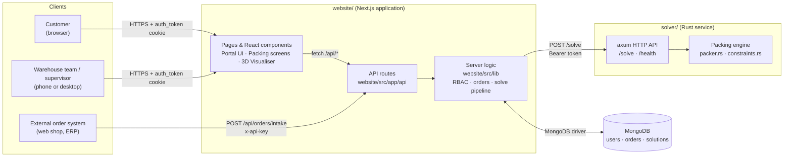
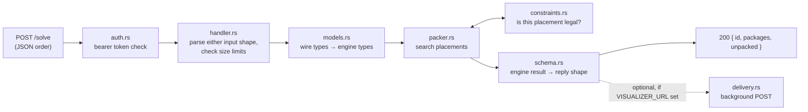
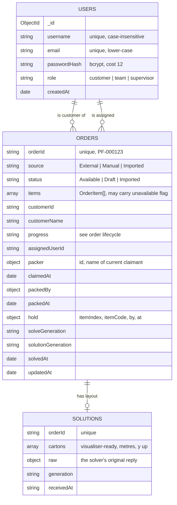
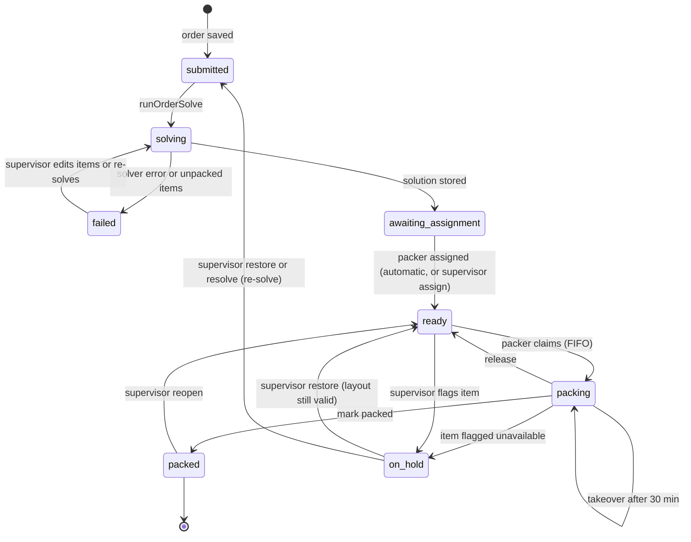
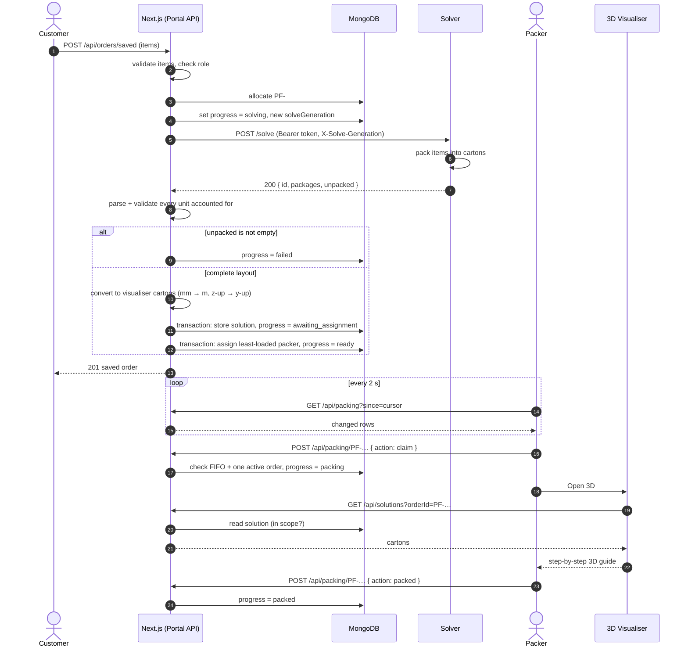

# System Architecture

## Table of Contents

1. [System Overview](#1-system-overview)
2. [High-Level Architecture & System Diagram](#2-high-level-architecture--system-diagram)
3. [Subsystem Breakdown](#3-subsystem-breakdown)
   - [3.1 Portal & API Gateway (`website/src/app`)](#31-portal--api-gateway-websitesrcapp)
   - [3.2 3D Visualiser Subsystem (`website/src/components/visualiser-v2`)](#32-3d-visualiser-subsystem-websitesrccomponentsvisualiser-v2)
   - [3.3 Solver Subsystem (`solver/`)](#33-solver-subsystem-solver)
   - [3.4 Data Persistence Layer (`MongoDB`)](#34-data-persistence-layer-mongodb)
4. [End-to-End Data Flow & Sequence Diagram](#4-end-to-end-data-flow--sequence-diagram)
   - [4.1 Order Lifecycle](#41-order-lifecycle)
   - [4.2 Sequence Diagram](#42-sequence-diagram)
   - [4.3 Coordinate and Unit Conversion](#43-coordinate-and-unit-conversion)
5. [Architectural Decision Records (ADRs)](#5-architectural-decision-records-adrs)
   - [ADR-001: Next.js App Router for Unified Fullstack Architecture](#adr-001-nextjs-app-router-for-unified-fullstack-architecture)
   - [ADR-002: Declarative 3D Graphics via React Three Fiber](#adr-002-declarative-3d-graphics-via-react-three-fiber)
   - [ADR-003: Decoupled Solver Contract with Runtime Wire Parsing](#adr-003-decoupled-solver-contract-with-runtime-wire-parsing)
   - [ADR-004: Stateless JWT Authentication with HTTP-Only Cookies](#adr-004-stateless-jwt-authentication-with-http-only-cookies)
   - [ADR-005: Synchronous Solve with Generation Tokens](#adr-005-synchronous-solve-with-generation-tokens)
   - [ADR-006: Rust for the Packing Engine](#adr-006-rust-for-the-packing-engine)
6. [Non-Functional Attributes & Quality Standards](#6-non-functional-attributes--quality-standards)

---

## 1. System Overview

Perfect fit is a warehouse packing assistant. It takes a customer order (a list of rectangular items with dimensions and weights), works out how to pack those items into as few cartons as possible, and shows warehouse staff a 3D, step-by-step view of where each item goes. The intended user is a warehouse worker on a phone, so the interface is mobile-first.

The system is made of three cooperating parts, each owned by a different team:

| Part | Team | Technology | Responsibility |
| :--- | :--- | :--- | :--- |
| **Portal** | Epic Portal | Next.js (App Router), TypeScript | Authentication, role-based access, order intake and management, packing workflow, data storage in MongoDB, and the API gateway to everything else |
| **Visualiser** | Epic Visualiser | React Three Fiber / three.js, TypeScript | Interactive 3D rendering of packing solutions for packers |
| **Solver** | Epic Solver | Rust (axum, tokio) | The 3D bin-packing engine: decides which carton each item goes in, and exactly where |

All saved data (user accounts, orders and packing solutions) is stored in a **MongoDB** database, which the Portal team owns. The Portal and Visualiser ship together as a single Next.js application in `website/`; the Solver is a separate Rust service in `solver/`.

---

## 2. High-Level Architecture & System Diagram

The system is a **three-tier architecture** with one extra back-end service. Browsers communicate only with the Next.js application. The Next.js server is the single gateway: it authenticates every request, reads and writes MongoDB, and calls the Solver on the user's behalf. The Solver is never exposed to browsers and holds no state of its own.

**Trust boundaries**

| Boundary | How it is protected |
| :--- | :--- |
| Browser → Next.js | `auth_token` JWT in an HTTP-only cookie; role re-read from MongoDB on every request; permission checked on every API route (`website/src/lib/rbac.ts`) |
| External system → Next.js | Shared API key (`ORDER_INTAKE_API_KEY`), compared in constant time; only order items are accepted from the sender |
| Next.js → Solver | Bearer token (`SOLVER_AUTH_TOKEN`) checked before any JSON is parsed; HTTPS required except on loopback |
| Next.js → MongoDB | Connection string held only in server environment variables (`MONGODB_URI`) |

---

## 3. Subsystem Breakdown

### 3.1 Portal & API Gateway (`website/src/app`)

The Portal consists of the user-facing pages of the Next.js application and the server-side layer through which all requests pass.

**Pages** (server components check the session and role before rendering, and redirect if access is not allowed):

| Route | Who | Purpose |
| :--- | :--- | :--- |
| `/` | Everyone | Redirects to `/portal` when signed in, `/login` otherwise |
| `/login`, `/register` | Public | Sign in with a username or email; create a customer account |
| `/portal` | All roles | Dashboard with quick actions for the user's role |
| `/orders` | All roles | The orders desk: create orders manually or import them from JSON/CSV, view and (supervisors) edit or delete orders |
| `/packing` | Team, supervisor | The live packing list; shows the orders assigned to the packer (supervisors see all) |
| `/packing/[orderId]` | Team, supervisor | One order's items and packing actions: start, release, mark packed, flag unavailable, open 3D |
| `/visualiser` | Team, supervisor | The 3D packing guide (see [3.2](#32-3d-visualiser-subsystem-websitesrccomponentsvisualiser-v2)) |
| `/admin/roles` | Supervisor | Search users and change their role |
| `/settings` | Team, supervisor | Visualiser display preferences; sign out |
| `/account` | All roles | Profile and sign out |

**API routes** live under `website/src/app/api` and are documented endpoint by endpoint in the [API Specification](./api.md). Every route follows the same pattern:

1. `requireUser()` resolves the session, or returns `401`.
2. `requirePermission(user, action)` checks the role, or returns `403`.
3. `orderScope(user)` (or an `assignedUserId` filter) narrows the database query to what this user may see.
4. The business logic in `website/src/lib` runs, and the route turns its result into an HTTP response.

**Server logic** in `website/src/lib` is kept out of the route files so it can be reused and tested in isolation:

| Module | Responsibility |
| :--- | :--- |
| `auth.ts`, `rbac.ts`, `apiKey.ts` | Session decoding, the role/permission table, constant-time API key checks |
| `mongodb.ts` | One shared `MongoClient`, and creation of every index on start-up |
| `orders.ts`, `orders/validateOrder.ts` | Order and item types, and validation of every incoming order |
| `orders/generateOrderId.ts` | Atomic, sequential `PF-000123` order IDs from a counter document |
| `orders/progress.ts` | The order state machine: progress values, labels per role, claim expiry (30 min) and the packed window (12 h) |
| `orders/autoAssign.ts` | Assigns each solved order to the team member with the lightest current workload |
| `orders/claimAssigned.ts` | Enforces one active order per packer and oldest-first (FIFO) claiming |
| `orders/packing.ts` | The packing list queries and every packing action (`claim`, `release`, `packed`, `unavailable`, `restore`, `assign`, `resolve`, `reopen`) |
| `solver/request.ts`, `solver/orderAdapter.ts`, `solver/parser.ts`, `solver/boxTypes.ts` | Build the exact `/solve` request from a saved order, including the carton catalogue |
| `solver/server/client.ts` | The authenticated HTTP call to the solver, with a 15 s timeout |
| `solver/server/runOrderSolve.ts` | The whole solve pipeline: lock the order, call the solver, validate, store, assign |
| `solver/solution.ts` | Parse and validate the solver's reply, and convert it to visualiser cartons |
| `app/lib/solutionStore.ts` | Store a solution and move the order on, in a single transaction |

**Order intake** has three routes in, which all end in the same pipeline:

| Source | Entry point | `source` stored |
| :--- | :--- | :--- |
| Manual entry on the orders desk | `POST /api/orders/saved` | `Manual` |
| JSON or CSV file import on the orders desk | `POST /api/orders/saved` (one call per order in the file) | `Imported` |
| Another system, machine-to-machine | `POST /api/orders/intake` | `External` |

### 3.2 3D Visualiser Subsystem (`website/src/components/visualiser-v2`)

The Visualiser renders each carton of a solved order and animates items dropping into place in packing order.

| File | Responsibility |
| :--- | :--- |
| `visualiserClient.tsx` | Takes a solved `Order` and renders the package picker, canvas, controls and item side panel. Owns the zoom level and the reducer state |
| `visualiserCanvas.tsx` | The React Three Fiber `<Canvas>`: package grid, selected-package inspection, drop animation (`useFrame`) |
| `visualiserControls.tsx` | Step between packages and between items, switch between package and item inspection, reset the selection, and zoom |
| `itemInfoPanel.tsx` | Details for the item being inspected: SKU, reference, box group, weight, position, size and volume |
| `types.ts` | Shared types (`VisualiserCarton`, `packingItem`, `vector3Data`) |

The page itself is `website/src/app/visualiser/VisualiserClient.tsx`. It reads an optional `?orderId=` query parameter, fetches the solution (see `solutionPolling.ts` below) and hands the converted `Order` to the component above. Packers reach it from the *Open 3D* button on the packing screen.

Supporting logic lives in `website/src/lib/`:

- `visualiserState.ts`: a **reducer** (`visualiserReducer`, `initVisualiserState`, `getDisplayState`) that holds which package is selected and which item the user is on. Keeping this as a plain reducer separates state transitions from rendering.
- `visualiserGeometry.ts`: pure functions for scaling and camera framing (`fitScale`, `getPackageViewDiameter`).
- `visualiserConfig.ts`: a `Partial<VisualiserConfig>` of colours, opacities, grid layout and animation timings, so appearance is tunable without touching rendering code.
- `solutionPolling.ts`: polls `GET /api/solutions?orderId=…` (or `?latest=true` when no order is given) every 2 seconds with a 10 second timeout. Polls run one at a time so a slow response cannot overwrite newer data, and the last good solution stays on screen if a refresh fails. It validates the response and converts stored cartons to the Visualiser's `Order` model (`convertCartonsToV2Order` in `app/lib/responseParser.ts`).

### 3.3 Solver Subsystem (`solver/`)

The Solver is a stateless Rust HTTP service built on **axum** and **tokio**. It receives an order and a list of carton types, and returns where every item goes. It keeps no database and no carton catalogue: everything it needs arrives in the request. The Solver team's own guide is [`solver/README.md`](../solver/README.md).

| File | Responsibility |
| :--- | :--- |
| `src/main.rs` | Starts the server on `LISTEN_ADDR` (default `127.0.0.1:8080`) |
| `src/api/router.rs` | Maps `/solve` and `/health` to handlers; applies authentication to `/solve` and a 4 MB body limit |
| `src/api/auth.rs` | Rejects any `/solve` request without the correct `Authorization: Bearer` token, before the body is read |
| `src/api/handler.rs` | Reads the order, enforces the 10,000-item and 100-carton-type limits, and runs the packer on a blocking thread so the server stays responsive |
| `src/api/schema.rs` | The request and response shapes as JSON |
| `src/api/delivery.rs` | Optional background delivery of each solution to a configured URL, with retries |
| `src/models.rs`, `src/types.rs` | Wire-format types, and the types the engine works in |
| `src/packer.rs` | The packing algorithm |
| `src/constraints.rs` | Every rule on whether a placement is legal |
| `src/bin/demo.rs` | Packs a hard-coded order and prints the layout, for quick manual checks |

**How the packing engine works**

- **Free-space tracking.** The packer tracks the *maximal free spaces* left in each carton, rather than bare anchor points. Each placement subtracts its footprint from the spaces it overlaps, so the search can score how snugly an item fits a gap.
- **Carton choice.** Before opening a carton, it trial-packs every eligible carton type and commits the best one. The priorities are: pack as many items as possible, then use the fewest cartons, then the least total carton volume.
- **Several orderings.** A greedy packer is sensitive to the order items are tried in, so the whole job is packed once per sort rule and the best run is kept. The approach follows Crainic, Perboli and Tadei's extreme-point heuristics for 3D bin packing.
- **Legality.** Every candidate placement goes through `constraints.rs`: weight limits (including the carton's own weight), carton supply caps, at least 80% support under every item, load bearing, and compatibility groups. Items with different `BoxGroup` values never share a carton.
- **Partial results.** The Solver does not reject a whole order because one line cannot be packed. Items that fit nowhere are listed in `unpacked` with a reason code. (The Portal then chooses to treat any unpacked item as a failed solve; see [ADR-005](#adr-005-synchronous-solve-with-generation-tokens).)

### 3.4 Data Persistence Layer (`MongoDB`)

MongoDB is the only store of state in the system. The connection is created once per server process in `website/src/lib/mongodb.ts`, which also creates every index on start-up, before any request is served. The database name comes from `MONGODB_DB` (default `fitvisualizer`).

| Collection | Contents |
| :--- | :--- |
| `users` | Accounts and roles |
| `orders` | Orders, their items, and the full packing state (progress, assignment, claim, hold) |
| `solutions` | One packing layout per order: the visualiser-ready cartons plus the raw solver reply |
| `counters` | The sequence behind `PF-` order IDs |
| `packingLocks`, `roleLocks` | Small documents that force concurrent assignments, claims and role changes to retry instead of racing |

**Indexes** (`ensureIndexes` in `mongodb.ts`) enforce unique emails, case-insensitive unique usernames, unique order IDs and one solution per order, and support the packing list, live updates and per-packer workload queries.

**Transactions.** Any change that touches more than one document runs in a MongoDB transaction: saving a solution and moving the order on, editing items and dropping the old solution, deleting an order, assigning a packer, claiming an order, and changing roles. **Transactions need a replica set**, so MongoDB must run as a replica set (Atlas does this by default). See the [Setup & Deployment Guide](./setup.md#3-database-setup).

---

## 4. End-to-End Data Flow & Sequence Diagram

### 4.1 Order Lifecycle

Every order moves through the `progress` states below. The state is the single source of truth for what each role sees and which actions are allowed.

### 4.2 Sequence Diagram

The main path, from a customer saving an order to a packer finishing it:

Compared with the earlier proposals in [`diagram.md`](./diagram.md) and `archivedREADME.md`, the Solver no longer pushes solutions to the Visualiser. The Portal calls the Solver and reads the solution from the **direct reply**, which removed the need for the Solver to know any other service's address and made the flow testable end to end. The Solver's push delivery (`VISUALIZER_URL`) still exists but is off by default.

### 4.3 Coordinate and Unit Conversion

The Solver and three.js use different conventions. The conversion is done once, on the server, when the solution is stored (`toVisualiserCartons` in `website/src/lib/solver/solution.ts`), so the browser never handles raw solver data.

| Quantity | Order (user input) | Solver request / reply | Stored solution & Visualiser |
| :--- | :--- | :--- | :--- |
| Length | mm | mm | metres (÷ 1000) |
| Weight | grams | kg (÷ 1000) | kg |
| Vertical axis | Not applicable | z | y (y and z swapped) |

Weights, box groups and carton references are not in the Solver's reply. They are restored by matching each placed item back to the request the Portal sent.

---

## 5. Architectural Decision Records (ADRs)

### ADR-001: Next.js App Router for Unified Fullstack Architecture

**Status:** Accepted

**Context.** The Portal and Visualiser teams both build web UI, and the Portal also needs a server: authentication, a database, and a gateway to the Solver. Running a separate front-end and back-end would mean two deployments, a CORS setup, and duplicated types across a network boundary.

**Decision.** Build the Portal and Visualiser as one **Next.js (App Router)** application in TypeScript. Pages are React server components that check the session before rendering; API endpoints are route handlers under `app/api`; shared server logic sits in `src/lib` and is marked `server-only` where it holds secrets.

**Consequences.**
- One deployment, one origin, and no CORS between UI and API.
- Types such as `OrderItem` and `VisualiserCarton` are shared directly between the server and the browser.
- Route protection happens on the server before a page reaches the browser, so access to restricted pages is enforced by the server and not only by the UI.
- The two teams share one codebase, so the `website/` CI (lint, typecheck, build) checks both teams' changes together.

### ADR-002: Declarative 3D Graphics via React Three Fiber

**Status:** Accepted

**Context.** Packers need an interactive 3D view that works on a phone. Raw three.js is imperative and does not integrate directly with React's render cycle, which makes state (selected carton, current item) harder to keep in sync with the scene.

**Decision.** Use **React Three Fiber** (`@react-three/fiber`) with **drei** helpers on top of three.js. Scene state is held in a plain reducer (`visualiserState.ts`); geometry maths are pure functions (`visualiserGeometry.ts`); appearance is driven by a typed config (`visualiserConfig.ts`).

**Consequences.**
- The 3D scene is ordinary React components, so the Visualiser team works in the same idioms as the rest of the app.
- State transitions can be reasoned about and unit-tested without rendering anything.
- Adds three.js to the bundle; the Visualiser page is only reachable by staff, so customers do not load it.

### ADR-003: Decoupled Solver Contract with Runtime Wire Parsing

**Status:** Accepted

**Context.** The Solver is written in Rust by a separate team and changes on its own schedule. TypeScript types do not describe what arrives over the network at runtime, and a malformed or partial solution shown to a packer could result in an incorrectly packed order.

**Decision.** Treat the Solver as an external service behind a written contract ([`solver/docs/output_schema.md`](../solver/docs/output_schema.md)). Every reply is parsed and validated at runtime before it is stored (`parseSolverSolution` and `validateSolverSolution` in `website/src/lib/solver/solution.ts`): the shape is checked field by field, and every physical unit in the request must appear exactly once in the reply. The request sent and the carton catalogue are built in one place (`buildSolverRequest`, `boxTypes.ts`).

**Consequences.**
- An invalid reply is rejected with `502` and the field path, and does not reach the Visualiser.
- Each team can change its internal implementation provided the contract is kept.
- Contract changes need agreement between teams; additions such as `unpacked` were negotiated and recorded in the Solver's docs.

### ADR-004: Stateless JWT Authentication with HTTP-Only Cookies

**Status:** Accepted

**Context.** Users sign in on shared warehouse devices and phones. Sessions must survive page loads without a session store, and the token must not be readable by page scripts.

**Decision.** On login, issue an **HS256 JWT** signed with `JWT_SECRET`, valid for 24 hours, in an **HTTP-only, `SameSite=Lax`** cookie (`Secure` in production). Passwords are hashed with **bcrypt** (cost 12). The token identifies the user, but the **role is re-read from MongoDB on every request**, and if the database cannot be reached the user is treated as a customer (fail closed).

**Consequences.**
- No session table; any server instance can verify a request.
- Page scripts cannot read the token, which reduces the token's exposure to cross-site scripting.
- Promotions and demotions take effect on the user's next request, at the cost of one indexed lookup per request.
- A token cannot be revoked before it expires; deleting the user account is the way to end a session early.

### ADR-005: Synchronous Solve with Generation Tokens

**Status:** Accepted (replaces the Sprint 1 and Sprint 2 push-based flows in [`diagram.md`](./diagram.md))

**Context.** Earlier designs had the Solver push solutions to the Visualiser or Portal. That required the Solver to know other services' addresses, lost solutions when the receiver was down, and made it possible for a slow, outdated solve to overwrite a newer one after an order was edited.

**Decision.** The Portal calls `POST /solve` and waits for the reply (15 s timeout). Each attempt gets a random solve generation; the solution is only accepted if the order is still `solving` under that same generation, and storing it and moving the order on happen in **one transaction**. The Portal also refuses any reply with unpacked items, so packers never see a partial layout.

**Consequences.**
- Solutions from superseded attempts are rejected, so edits and re-solves take precedence over older attempts.
- Large orders are bounded by the 15 s timeout. The Solver's load tests verified orders up to 10,000 items.
- An order that cannot be fully packed is marked `failed` and needs a supervisor to edit it, rather than being half-packed.

### ADR-006: Rust for the Packing Engine

**Status:** Accepted

**Context.** 3D bin packing is computationally intensive: the engine trial-packs every carton type and repeats the job under several item orderings. It must answer within the Portal's timeout on large orders.

**Decision.** Write the Solver in **Rust** with **axum** for HTTP. Packing runs on a blocking thread (`spawn_blocking`) so a long job does not stall other requests.

**Consequences.**
- Compiled execution without garbage-collection pauses; typed parsing of the wire format via `serde`.
- A separate build and deployment from the website, with its own CI workflow (`solver.yaml`).
- Fewer team members are familiar with Rust, so the Solver's source includes explanatory comments for developers new to the language.

---

## 6. Non-Functional Attributes & Quality Standards

| Attribute | Target / standard | How it is achieved |
| :--- | :--- | :--- |
| **Security** | Least privilege; no secret reaches a browser | Role-based permissions on every route; role re-read from the database; HTTP-only cookies; bcrypt password hashing; constant-time API key and token comparison; bearer token on the Solver; HTTPS enforced for non-local Solver calls; out-of-scope records answered with `404` so IDs cannot be probed; regex input escaped on user search |
| **Data integrity** | Each order has at most one current layout, from its latest solve | Unique indexes; atomic order IDs; multi-document transactions; solve generations; optimistic concurrency on order edits (`409` if changed) |
| **Reliability** | A failure in one component does not stop the others | Solver returns partial results instead of failing an order; Portal refuses partial layouts; Visualiser keeps the last good solution on screen if a refresh fails; polling backs off on errors (up to 30 s) and pauses when the tab is hidden |
| **Performance** | Smartphone: usable in under 1 s, over 60 Hz rendering, input response under 5 ms, carton rendered under 1 s after data arrives | Solutions converted on the server, not in the browser; incremental packing-list updates (`?since=`); `204` when an order has not changed; indexes on every hot query |
| **Scalability** | Up to 10,000 items per order; several packers at once | Solver limits enforced with `413`; packing on a blocking thread; packers' claims are independent; Solver is stateless and can run as several instances |
| **Usability** | A new packer completes a first order with minimal instruction | Mobile-first layout; each screen shows the actions available for the order's current state; FIFO order chosen for the packer; error messages that state the cause (`Pack order PF-000040 first.`) |
| **Accessibility** | Usable without relying on colour; keyboard and screen-reader friendly | Labelled controls and ARIA labels on navigation, packing and Visualiser controls; `prefers-reduced-motion` respected by the side menu; contrast checks (see [Team Roles](./roles.md#42-team-objectives)) |
| **Maintainability** | A new developer can locate and change code, with CI checks in place | Strict TypeScript; component-based UI; business logic separated from routes; ADRs; consistent documentation; all changes through reviewed pull requests |
| **Quality gates** | Every change to `main` passes CI | CI runs lint, typecheck and build for the website, and format, clippy, build, tests and demo for the Solver, on every pull request. See [Software Quality & Testing](./quality.md) |
