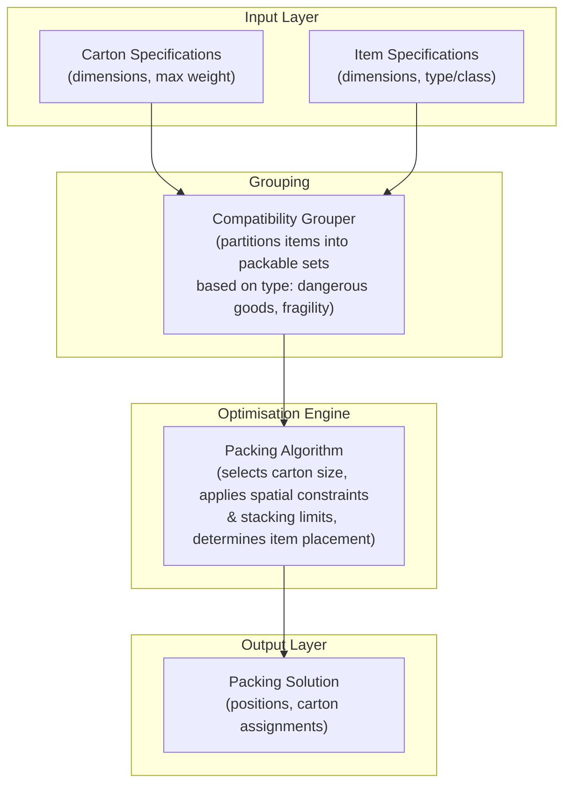

# Solver Team Overview

The solver team owns the core optimisation engine of Project Perfect Fit. At a high level, the engine takes two JSON inputs, carton specifications (dimensions, max weight) and item specifications (dimensions, type/class), and determines the optimal way to pack those items into cartons.

All items are assumed to be rectangular. A key constraint is item compatibility: certain items cannot be packed together (e.g. dangerous goods with general freight), so the engine must classify items and group them into valid packable sets before attempting to arrange them.

## Architecture



Proposed layers of the engine:

1. **Input:** Receives carton and item data as JSON.
2. **Classification & Grouping:** Tags items by type and partitions them into compatible groups.
3. **Constraint:** Applies compatibility rules (dangerous goods, fragility) and spatial constraints (weight limits, stacking).
4. **Optimisation:** Selects appropriate carton sizes and runs the 3D bin-packing algorithm to determine item placement.
5. **Output:** Returns a packing solution (item positions, carton assignments) and an optional utilisation report.

## Project layout

```
solver/
├── Cargo.toml
└── src/
    ├── main.rs         # The server. What "cargo run" starts.
    ├── lib.rs          # Crate root, re-exports models::* and the Packer
    ├── models.rs       # The wire format types (Item, BoxType, PackedBox, ...) and conversions to types.rs
    ├── types.rs        # The types the packer works in (Item, Container, Space, ...)
    ├── constraints.rs  # Every rule on whether a placement is legal
    ├── packer.rs       # The packing algorithm
    ├── bin/            # Extra programs, each run with "cargo run --bin <name>"
    │   └── demo.rs           # Packs a hardcoded order and prints the layout
    └── api/
        ├── mod.rs      # Declares the delivery, handler, schema and router submodules
        ├── delivery.rs # Sends finished solutions on to the visualiser
        ├── handler.rs  # The functions answering /solve and /health
        ├── router.rs   # Which URL maps to which handler, plus the CORS layer
        └── schema.rs   # The request and response shapes, as JSON
```

### The packing engine (packer.rs + constraints.rs)

This is the code behind the /solve endpoint and the demo binary:

- models.rs holds the types the API reads and writes. The handler converts them into the types.rs equivalents on the way in (BoxGroup becomes the compatibility group, BoxType becomes Container) and back again on the way out, and the result is reshaped into the visualiser's format in api/schema.rs.
- packer.rs tracks maximal free spaces rather than anchor points, scores each candidate position by how snugly it fits, trial-packs every eligible carton type before committing one, and repeats the whole job under several item orderings, keeping the best run.
- constraints.rs decides whether each candidate is legal: weight limits (counting the carton's own weight), supply caps, at least 80% support underneath every item, load bearing, and compatibility groups.
- Compatibility is strict: each BoxGroup only shares cartons with its own group, and items with no BoxGroup are a group of their own, so they never share with tagged items.
- Packs everything it can and never gives up on a whole order. Anything that fits no available box is listed under unpacked on the solution with a reason code, so one oversized line costs you that line and nothing else.

### Running the server

`cargo run` starts the HTTP server, and it keeps running until you stop it with Ctrl-C.

```bash
cd solver
cargo run
```

It prints the address it is listening on. By default that is `0.0.0.0:8080`, where `0.0.0.0`
means "accept connections on any network interface". That is deliberately wider than
`127.0.0.1`, which would only accept connections from your own machine: the warehouse worker
opens this from their phone, so other devices on the same network have to be able to reach
it.

To listen somewhere else, set the `LISTEN_ADDR` environment variable. This is useful when
port 8080 is already taken by something else:

```bash
LISTEN_ADDR=127.0.0.1:9099 cargo run
```

#### Sending solutions to the visualiser

The Sprint 2 data flow in [docs/diagram.md](../docs/diagram.md) has the portal sending orders
to the solver, the solver sending each finished solution to the visualiser, and the
visualiser passing it on to the portal. The solver sends nothing to the portal itself. The
visualiser's address comes from the environment, so it is not compiled in:

```bash
VISUALIZER_URL=http://192.168.1.20:3000/solutions cargo run
```

| Variable | Effect |
| --- | --- |
| `VISUALIZER_URL` | Where to POST each solution. |

**It is not set by default, and without it nothing is sent anywhere.** That is the normal
state while developing, and it makes the solver behave exactly as it did before deliveries
existed, so you do not need the visualiser running to work on it. The server prints whether
it picked up an address when it starts. `PORTAL_URL`, which used to receive a second copy
under Sprint 1, is no longer read; if it is set, the server says so at startup and ignores it.

What gets sent is the same body the caller of `/solve` receives, byte for byte. Points worth
knowing before wiring this up to a real endpoint:

- **The solver does not wait for the delivery.** The caller gets their answer on their own
  connection and the copy goes out behind it. A visualiser that is down is logged and that
  solution is lost: there is no queue and nothing is retried. Anything stronger needs
  somewhere to store solutions, which the solver deliberately does not have.
- **Send an `id`** on the order (or `OrderId` in the older shape) if you want the solution tied
  back to the order it came from. It comes back as `id` on the solution. An order without one
  still gets an identifier, made up by the solver and shaped `solve-<milliseconds>-<count>`,
  so the visualiser always has something to key on.
- **Only `http` addresses work in this build.** TLS is left out because the library providing
  it needs cmake and a C compiler, which is a poor trade while everything is on one local
  network. An `https` address is warned about at startup; turning TLS on is a one line change,
  adding the `rustls` feature to `reqwest` in `Cargo.toml`.
- **CORS has nothing to do with this.** It is a rule browsers apply to pages they are running.
  A POST from this process to another server is not subject to it.

#### Endpoints

| Route | Method | What comes back |
| --- | --- | --- |
| `/health` | GET | 200 and the text `ok`. It does no work; a reply just means the server is running. The frontend uses it to check the solver is available. |
| `/solve` | POST | 200 and the solution in the visualiser's shape. A copy also goes to the visualiser when `VISUALIZER_URL` is set. |

`/solve` accepts an order in either of two shapes, told apart by whether the items sit under
`items` or `Items`:

- **The portal's shape**, as in `data_format_example/input_from_portal.json`: lowercase
  top-level keys `id`, `source`, `status`, `items` and `boxTypes`, with each item and each box
  type using the PascalCase fields below. `source` and `status` are accepted and ignored.
  Every item needs a `Weight`, and the order needs `boxTypes`, the cartons it may be packed
  into, because the solver keeps no carton catalogue. The portal's example has neither yet,
  so posting it as-is gets a 422 naming the first missing field.
- **The older shape**, a `PackingRequest` with PascalCase `Items`, `BoxTypes` and an optional
  `OrderId`. `docs/example_data/combined.json` and the test pages use it.

The reply, in both cases, is the shape in `data_format_example/solved_soltuion_example.json`
plus one added key, `unpacked`:

```json
{
  "id": "Order-A",
  "packages": [
    {
      "size": { "x": 400, "y": 400, "z": 400 },
      "items": [
        { "position": { "x": 0, "y": 0, "z": 0 }, "size": { "x": 200, "y": 100, "z": 100 } }
      ]
    }
  ],
  "unpacked": [
    {
      "itemCode": "LEAD", "itemReference": "Lead Sheet",
      "size": { "x": 490, "y": 440, "z": 10 }, "weight": 3.9, "reason": "TooHeavy"
    }
  ]
}
```

Each package is one carton. Every number is millimetres. `x`, `y` and `z` are the carton's
Width, Length and Depth, and **z is vertical**, which is worth flagging to anyone drawing this
in a y-up scene such as three.js. An item's `size` is after rotation. Item codes, weights,
groups and carton names are not in a package.

`unpacked` lists the items that fit nowhere, and is always present, empty when everything
was placed. A 200 does not mean every item was packed, so read it. Each entry's `size` is as
ordered, since it was never placed, and `reason` is one of four fixed codes:

| Code | Meaning |
| --- | --- |
| `TooLarge` | Bigger than every carton offered, in every orientation it may take. |
| `TooHeavy` | Fits inside at least one carton but outweighs what every such carton may carry. |
| `SupplyExhausted` | Would fit, but every carton type that could hold it hit its `MaximumBoxes`. |
| `CartonLimitReached` | Would fit, but the run hit its ceiling on cartons opened first. |

When more than one applies, the nearest miss wins. The visualiser team has agreed to
`unpacked`, though their example file does not have it yet. The full contract, with a
complete example, is in `docs/output_schema.md`.

`/solve` has these failure cases, which are separate on purpose so a caller can tell them
apart:

- **422** means the body was JSON but not a usable order of either shape, for example a
  missing or misspelled field. The body is JSON, `{"Error": "..."}`, naming the field.
- **400** means the order was understood but nothing at all could be packed, for example a
  single pallet against a set of small cartons. The body is JSON, `{"Error": "..."}`. An
  order where even one item fits somewhere is answered with 200 and a partial solution. An
  order with no items in it is not a failure either, it comes back with no packages. A body
  that is not JSON at all is also a 400, rejected before the solver looks at it.
- **413** means the order is too big to take on: a body over 4 MB, more than 10,000 items,
  or more than 100 carton types. The limits are `MAX_BODY_BYTES` in `api/router.rs` and
  `MAX_ITEMS` and `MAX_BOX_TYPES` in `api/handler.rs`. 10,000 is the largest order the load
  tests in `data_format_example/generated` have verified. The fix is to split the order.
- **415** means the request had no `Content-Type: application/json` header. Like the
  non-JSON 400 and the over-4 MB 413, it comes from axum with a plain-text body rather
  than `{"Error": "..."}`.
- **500** means the packer itself crashed, which is a solver bug rather than anything wrong
  with the order.

`docs/example_data/combined.json` is a ready-made order you can post as-is. It was built by
combining the `items.json` and `boxes.json` in that same directory:

```bash
curl http://localhost:8080/health
curl -X POST http://localhost:8080/solve \
  -H 'Content-Type: application/json' \
  --data @docs/example_data/combined.json
```

#### A note on CORS

Browsers block a page served from one address from reading a response from a different
address, unless the responding server sends headers saying it is allowed. Those headers are
CORS, and `api/router.rs` adds them with `CorsLayer::permissive()`, which allows every
origin.

That is a development convenience, so the frontend can call this API while it is still
moving between addresses. **Before this server is reachable from outside a local network,
replace it with the specific addresses the portal and visualiser are served from.**

### Running the demo

The demo packs a hardcoded set of cartons and items and prints the layout as text. It is the
quickest way to exercise the solver without starting the server:

```bash
cd solver
cargo run --bin demo
```

Run the tests:

```bash
cd solver
cargo test
```

## Known limitations / open questions

- An order that packs nothing at all sends nothing out, since there is no solution to deliver. Everything short of that comes back as a partial solution and is delivered like any other.
- unpacked is our addition to the visualiser's shape and is not in their example yet, so it needs their sign-off.
- The solution carries no item identity, so the visualiser cannot label an item or map it back to an order line.
- The test pages under viewer/ rebuild names, weights and leftovers by matching the reply against the request they sent (viewer/solution.js). Two different items with identical sides cannot be told apart, so between those the code and weight shown are a guess; the geometry is always right. A saved answer opened from disk has no request to match, so it shows sizes only.
- The request has no fields for fragile, maximum load or this-way-up, so those rules exist in constraints.rs but are switched off for every item that arrives over the API.
- Deliveries are best effort. A solution that could not be handed over is logged and gone, and there is no way to ask for it again afterwards, since the solver keeps no record of it.
- CORS currently allows every origin. That is fine while everything runs on one local network, and not fine anywhere else. See the note in the Running the server section above.
