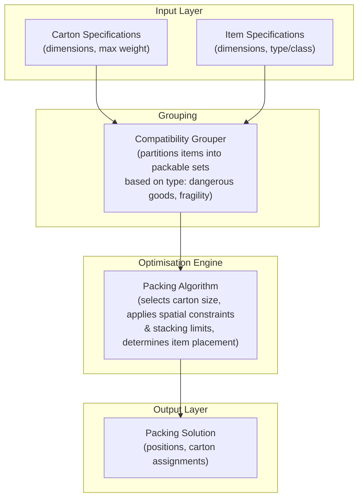

# Solver Team Overview

The solver team owns the core optimisation engine of Project Perfect Fit. At a high level, the engine takes two JSON inputs, carton specifications (dimensions, max weight) and item specifications (dimensions, type/class), and determines the optimal way to pack those items into cartons.

All items are assumed to be rectangular. A key constraint is item compatibility: certain items cannot be packed together (e.g. dangerous goods with general freight), so the engine must classify items and group them into valid packable sets before attempting to arrange them.

## Architecture



Proposed layers of the engine:

1. **Input:** Receives carton and item data as JSON.
2. **Classification & Grouping:** Tags items by type and partitions them into compatible groups.
3. **Constraint:** Applies compatibility rules (dangerous goods, fragility) and spatial constraints (weight limits, stacking).
4. **Optimisation:** Selects appropriate carton sizes and runs the 3D bin-packing algorithm to determine item placement.
5. **Output:** Returns a packing solution (item positions, carton assignments) and an optional utilisation report.

## Project layout

```
solver/
├── Cargo.toml
└── src/
    ├── main.rs         # The server. What "cargo run" starts.
    ├── lib.rs          # Crate root, re-exports models::* and the Packer
    ├── models.rs       # The wire format types (Item, BoxType, PackedBox, ...) and conversions to types.rs
    ├── types.rs        # The types the packer works in (Item, Container, Space, ...)
    ├── constraints.rs  # Every rule on whether a placement is legal
    ├── packer.rs       # The packing algorithm
    ├── bin/            # Extra programs, each run with "cargo run --bin <name>"
    │   └── demo.rs           # Packs a hardcoded order and prints the layout
    └── api/
        ├── mod.rs      # Declares the delivery, handler, schema and router submodules
        ├── delivery.rs # Sends finished solutions on to the visualiser and portal
        ├── handler.rs  # The functions answering /solve and /health
        ├── router.rs   # Which URL maps to which handler, plus the CORS layer
        └── schema.rs   # The request and response shapes, as JSON
```

### The packing engine (packer.rs + constraints.rs)

This is the code behind the /solve endpoint and the demo binary:

- models.rs holds the types the API reads and writes. The handler converts them into the types.rs equivalents on the way in (BoxGroup becomes the compatibility group, BoxType becomes Container) and back again on the way out, so the JSON the other teams see is unchanged.
- packer.rs tracks maximal free spaces rather than anchor points, scores each candidate position by how snugly it fits, trial-packs every eligible carton type before committing one, and repeats the whole job under several item orderings, keeping the best run.
- constraints.rs decides whether each candidate is legal: weight limits (counting the carton's own weight), supply caps, at least 80% support underneath every item, load bearing, and compatibility groups.
- Compatibility is strict: each BoxGroup only shares cartons with its own group, and items with no BoxGroup are a group of their own, so they never share with tagged items.
- Packs everything it can and never gives up on a whole order. Anything that fits no available box comes back in UnpackedItems instead of replacing the result, so one oversized line costs you that line and nothing else.

### Running the server

`cargo run` starts the HTTP server, and it keeps running until you stop it with Ctrl-C.

```bash
cd solver
cargo run
```

It prints the address it is listening on. By default that is `0.0.0.0:8080`, where `0.0.0.0`
means "accept connections on any network interface". That is deliberately wider than
`127.0.0.1`, which would only accept connections from your own machine: the warehouse worker
opens this from their phone, so other devices on the same network have to be able to reach
it.

To listen somewhere else, set the `LISTEN_ADDR` environment variable. This is useful when
port 8080 is already taken by something else:

```bash
LISTEN_ADDR=127.0.0.1:9099 cargo run
```

#### Sending solutions to the other teams

The Sprint 1 data flow in the [root README](../README.md) has the solver sending each finished
solution to the visualiser, with a copy to the portal, rather than only answering the caller
that asked for it. Both addresses come from the environment, so neither is compiled in:

```bash
VISUALIZER_URL=http://192.168.1.20:3000/solutions \
PORTAL_URL=http://192.168.1.21:4000/solutions \
cargo run
```

| Variable | Effect |
| --- | --- |
| `VISUALIZER_URL` | Where to POST the main copy of each solution. |
| `PORTAL_URL` | Where to POST the second copy. |

**Neither variable is set by default, and with neither set nothing is sent anywhere.** That is
the normal state while developing, and it makes the solver behave exactly as it did before
deliveries existed, so you do not need the portal or the visualiser running to work on it.
The server prints which destinations it picked up when it starts.

What gets sent is the same `PackingResponse` body the caller receives, byte for byte, so both
teams parse one shape. Points worth knowing before wiring this up to a real endpoint:

- **The solver does not wait for either delivery.** The caller gets their answer on their own
  connection and the copies go out behind it. A destination that is down is logged and that
  solution is lost: there is no queue and nothing is retried. Anything stronger needs
  somewhere to store solutions, which the solver deliberately does not have.
- **Send an `OrderId`** on the request if you want the solution tied back to the order it came
  from. It is echoed on the response and carried on both copies. A request without one still
  gets an identifier, made up by the solver and shaped `solve-<milliseconds>-<count>`, so a
  receiver always has something to key on.
- **Only `http` addresses work in this build.** TLS is left out because the library providing
  it needs cmake and a C compiler, which is a poor trade while everything is on one local
  network. An `https` address is warned about at startup; turning TLS on is a one line change,
  adding the `rustls` feature to `reqwest` in `Cargo.toml`.
- **CORS has nothing to do with this.** It is a rule browsers apply to pages they are running.
  A POST from this process to another server is not subject to it.

#### Endpoints

| Route | Method | What comes back |
| --- | --- | --- |
| `/health` | GET | 200 and the text `ok`. It does no work; a reply just means the server is running. The frontend uses it to check the solver is available. |
| `/solve` | POST | 200 and a `PackingResponse`: the `OrderId` this solution belongs to, where every item was placed, and `UnpackedItems` for anything that fit nowhere. A copy also goes to the visualiser and the portal when those are configured. |

`UnpackedItems` is always on the response and is almost always empty. An item that fits no
carton on offer is reported there rather than failing the order, so a solution still comes
back, and still reaches the visualiser and the portal, when part of an order cannot be
packed. Anything in that list needs a person to deal with.

`/solve` has two failure cases, which are separate on purpose so a caller can tell them
apart:

- **422** means the request body was not a valid `PackingRequest`, for example a missing or
  misspelled field. The problem is the request itself, and the body is a plain text message
  saying which field was wrong.
- **400** means the request was understood but nothing at all could be packed, for example a
  single pallet against a set of small cartons. The body is JSON, `{"Error": "..."}`. This is
  now the only packing failure: an order where even one item fits somewhere is answered with
  200 and a partial solution. An order with no items in it is not a failure either, it comes
  back as an empty solution.

`docs/example_data/combined.json` is a ready-made `PackingRequest` you can post as-is. It was
built by combining the `items.json` and `boxes.json` in that same directory:

```bash
curl http://localhost:8080/health
curl -X POST http://localhost:8080/solve \
  -H 'Content-Type: application/json' \
  --data @docs/example_data/combined.json
```

#### A note on CORS

Browsers block a page served from one address from reading a response from a different
address, unless the responding server sends headers saying it is allowed. Those headers are
CORS, and `api/router.rs` adds them with `CorsLayer::permissive()`, which allows every
origin.

That is a development convenience, so the frontend can call this API while it is still
moving between addresses. **Before this server is reachable from outside a local network,
replace it with the specific addresses the portal and visualiser are served from.**

### Running the demo

The demo packs a hardcoded set of cartons and items and prints the layout as text. It is the
quickest way to exercise the solver without starting the server:

```bash
cd solver
cargo run --bin demo
```

Run the tests:

```bash
cd solver
cargo test
```

## Known limitations / open questions

- An order that packs nothing at all still sends nothing out. This used to apply to any order with a single unplaceable item in it, and now only applies when no carton could be filled, since there is genuinely no solution to deliver in that case. Everything short of that comes back as a partial solution and is delivered like any other.
- UnpackedItems says what was left over but not why. The packer works out a reason for each item, but the response has no field for it yet, so it only reaches the caller in the error message of an order that packed nothing at all.
- The request has no fields for fragile, maximum load or this-way-up, so those rules exist in constraints.rs but are switched off for every item that arrives over the API.
- Deliveries are best effort. A solution that could not be handed over is logged and gone, and there is no way to ask for it again afterwards, since the solver keeps no record of it.
- CORS currently allows every origin. That is fine while everything runs on one local network, and not fine anywhere else. See the note in the Running the server section above.
