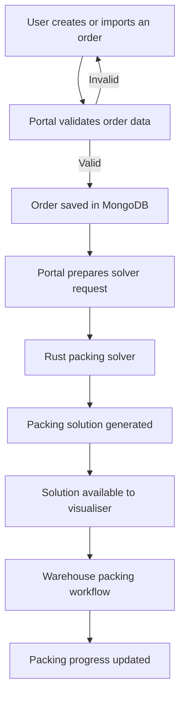

# Portal Team: Project Perfect Fit

The Portal is the web application for Project Perfect Fit, a warehouse order management and packing optimisation system. It provides a central interface for customers to submit orders and for warehouse staff to manage the packing process.

The Portal Team developed the application using Next.js, React, TypeScript and MongoDB. It communicates with a separate Rust-based solver responsible for calculating how items should be arranged inside cartons.

The portal connects the different stages of the warehouse workflow, from receiving an order to presenting a packing solution and tracking its completion.

The main objectives are to:

- Allow customers to create and import orders.
- Validate order information before processing.
- Store orders so they can be retrieved and managed.
- Send correctly formatted order data to the packing solver.
- Display packing solutions through a 3D visualiser.
- Assign packing work to warehouse staff.
- Track packing progress and order status.
- Restrict operations based on user roles and permissions.

## How the Portal Works

The portal follows an order-processing workflow involving the frontend, backend API, database, solver and visualiser.



This diagram shows the logical workflow rather than every HTTP request. The solver returns its result to the `/solve` caller and can separately deliver a copy to the visualiser service when configured.

### 1. Order Creation

Users begin by creating an order through the portal.

Two methods are supported:

**Manual order entry**

Users enter item information through a form, including dimensions, weight and quantity. The interface supports updating item values before the order is submitted.

**CSV and JSON imports**

Users can upload order information from CSV or JSON files instead of entering each item manually.

The portal parses imported information and converts it into its internal order representation.

Both methods allow orders to be processed through the same validation and solver-integration workflow.

### 2. Order Validation

Before processing an order, the portal checks the supplied information. Validation is important because the packing solver expects a specific data structure and valid numerical values.

The validation layer is intended to prevent malformed orders from being passed to the solver. This also allows input errors to be handled closer to the user rather than relying entirely on errors returned by the solver.

### 3. Order Storage

The portal uses MongoDB to save order information. It allows orders to be saved and retrieved without depending on the state of an individual browser session. The database is accessed through server side application logic rather than directly from frontend components.
During development, older saved orders were identified without the newer Weight field. This is an important compatibility consideration because the solver requires item weight information.

### 4. Preparing Orders for the Solver

The Portal and Solver Teams use different representations of some order information.

The portal hence uses an adapter to transform order data into the format expected by the Rust solver.

One important example is the item weight.

The portal accepts weight in grams, while the solver expects kilograms. The conversion is performed before the solver request:


weight: item.Weight / 1000


For example:

| Portal Input | Solver Input |
|---|---|
| 500 g | 0.5 kg |
| 1000 g | 1.0 kg |
| 2500 g | 2.5 kg |

The portal also converts Weight input into a numeric value when the user edits an item.

Keeping these conversions in the portal's data-processing layer avoids requiring users to understand the solver's internal data format.

### 6. Packing Solutions and Visualisation

After processing an order, the solver generates a packing solution. The solution describes how items are arranged within cartons, including carton dimensions and item positions.

## Warehouse Packing Workflow

The portal supports the warehouse process after an order is ready for packing.The packing interface displays orders and provides a way for staff to manage their progress.

### Order Statuses

The application uses the following statuses:

| Status | Meaning |
|---|---|
| `ready` | The order is waiting to be packed |
| `packing` | A packer is working on the order |
| `packed` | Packing has been completed |
| `on_hold` | Packing is temporarily paused |
| `failed` | Processing has failed |

These statuses allow the interface to distinguish between outstanding work, active work and completed orders.

### FIFO Assignment

The packing workflow is designed around First-In, First-Out (FIFO) processing.

Older ready orders should be prioritised before newer orders, while allowing multiple packers to work in parallel. The design also includes order claiming, assignment and progress updates.

### Live Updates

The packing interface uses polling to retrieve updated order information.

This allows the displayed packing list and progress information to be refreshed without requiring users to reload the entire page manually. 

## Authentication and Access Control

The portal includes user registration, login and logout functionality.

Authentication is used to establish which user is making a request.

Role based access control (RBAC) is used to determine which operations a user is authorised to perform.

The packing workflow distinguishes between:

- Customers
- Team members
- Supervisors

Permissions such as `order:pack` are used to control packing-related actions.

The portal also provides an administrative role-management interface.

Separating authentication from authorisation helps prevent users from performing actions outside their assigned responsibilities.

## Running the Portal

### Requirements

To run the portal locally, developers need:

- Node.js and npm compatible with Next.js 16.
- Access to the configured MongoDB database.
- The required application environment variables.
- The Rust solver running for packing optimisation.

### Step 1: Clone the Repository

```bash
git clone https://github.com/LTSmq/comp4050-epic-team.git
cd comp4050-epic-team/website
```

### Step 2: Install Dependencies

```bash
npm install
```

### Step 3: Configure the Environment

Configure the environment variables required for MongoDB, authentication and solver connectivity.

The required variable names and values must match the current application configuration.

Do not commit passwords, database credentials or authentication secrets to the repository.

### Step 4: Start the Portal

```bash
npm run dev
```

The development application is normally accessible at:

```text
http://localhost:3000
```

### Step 5: Start the Solver

The solver is a separate Rust application.

From the repository root, run:

```bash
cd solver
cargo run
```

By default, the solver listens on port `8080`.

To check whether it is running:

```bash
curl http://localhost:8080/health
```

A successful health response confirms that the solver server is reachable. It does not independently verify that a complete order can be packed.

## Development and Testing

The following commands can be run from the `website` directory.

| Command | Purpose |
|---|---|
| `npm run dev` | Run the development server |
| `npm run typecheck` | Check TypeScript types |
| `npm run lint` | Run ESLint |
| `npm run build` | Build the production application |
| `npm run start` | Start the production server |


## Design Decisions


### Server-Side Database Access

Database operations are handled through the application's server-side logic.

This keeps database connectivity and credentials separate from browser components.

### Dedicated Solver Adapter

Order-format and unit conversions are centralised in the solver adapter.

This reduces the risk of different components producing inconsistent solver requests.

### Polling for Packing Updates

The packing interface uses polling to obtain updated order information.

This provides a straightforward mechanism for refreshing packing data while multiple users interact with the system.

### Role Based Permissions

Authentication identifies users, while role-based permissions determine what they can do.

This separates user identity from operational authority within the warehouse workflow.

## Repository

**Project:** Project Perfect Fit

**Portal:** `website/`

**Repository:** https://github.com/LTSmq/comp4050-epic-team
